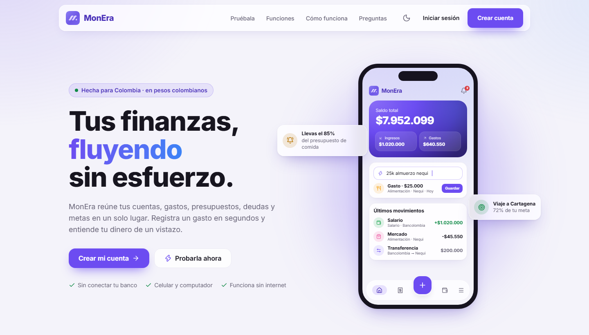
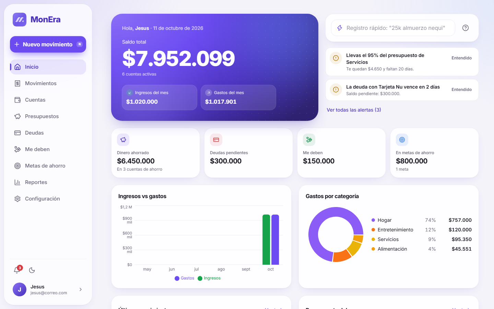
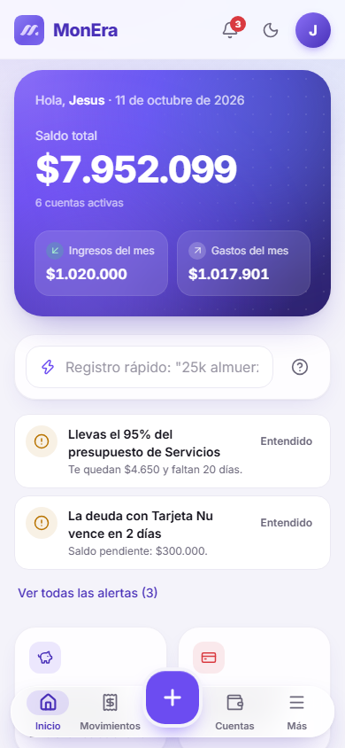
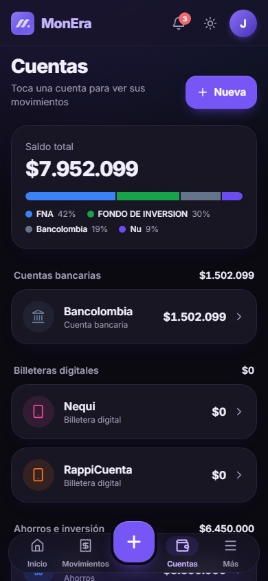
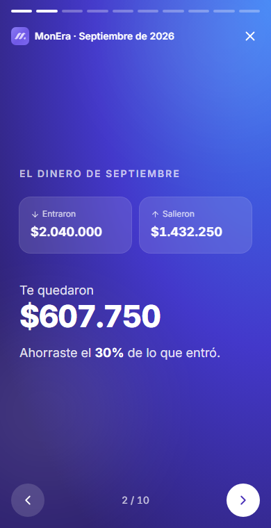
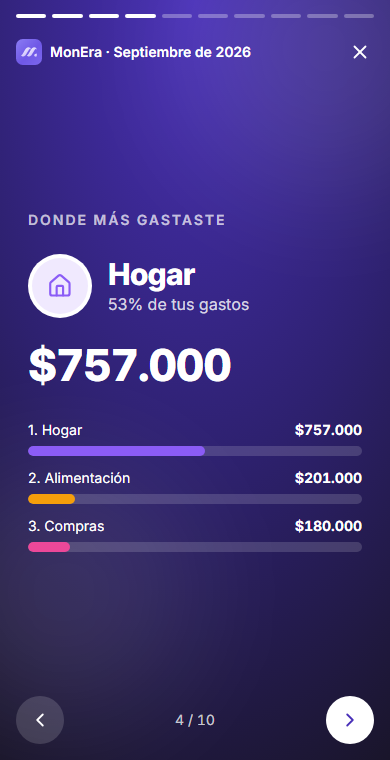
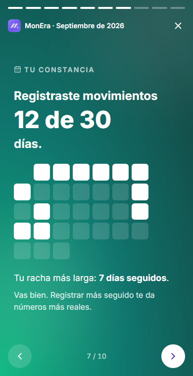
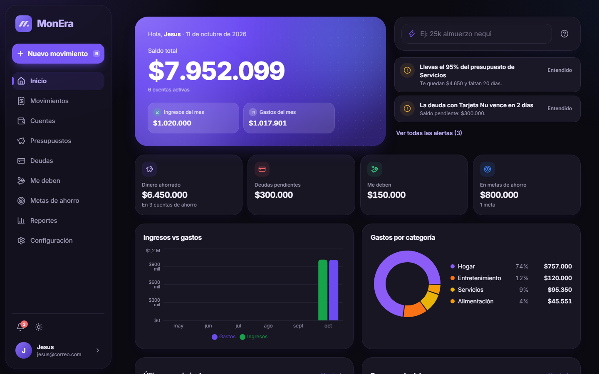

<div align="center">


# MonEra

**Tus finanzas personales, fluyendo sin esfuerzo.**

Una app web para ordenar tu dinero del día a día: cuentas, gastos, presupuestos, deudas, metas y pagos fijos en un solo lugar.
Hecha para Colombia, en pesos colombianos (COP). Se instala en el celular y funciona sin internet.

[**Abrir MonEra →**](https://monera-app.netlify.app)


[Funciones](#-funciones) · [Capturas](#-capturas) · [Tecnologías](#-tecnologías) · [Instalación local](#-instalación-local) · [Despliegue](#-despliegue)

<br />



</div>

---

## ✨ Funciones

| | |
|---|---|
| **⚡ Registro rápido** | Escribe `25k almuerzo nequi` y la app entiende el monto, la categoría, la cuenta y la fecha. Entiende "mil", "lucas", "palos", "ayer", "el lunes"… y aprende de cómo categorizas. |
| **🏦 Cuentas y billeteras** | Bancos, billeteras digitales, efectivo, ahorros y tarjetas, cada una con su saldo y su historial de movimientos (incluidas las transferencias entre cuentas). |
| **🔁 Pagos fijos** | Arriendo, internet, servicios, salario… Te los recuerda cuando toca y los registras con un toque. Montos fijos o variables, mensuales, quincenales, semanales o anuales, y modo automático. |
| **🔔 Alertas inteligentes** | Avisos cuando te acercas a un presupuesto, cuando un gasto se sale de lo normal, cuando una deuda está por vencer o cuando una cuenta no alcanza para tus pagos fijos. |
| **🎯 Presupuestos y metas** | Límites mensuales por categoría y metas de ahorro con su progreso. |
| **🤝 Deudas y préstamos** | Lo que debes y lo que te deben, con abonos e historial de lo ya pagado. |
| **📊 Reportes** | Ingresos vs. gastos, gastos por categoría, evolución del saldo y tasa de ahorro. |
| **✨ Resumen del mes** | Tu mes en tarjetas, estilo historias: cuánto ahorraste, dónde más gastaste, tu día más caro, tu constancia y más. |
| **📱 App instalable (PWA)** | Se instala en Android, iPhone y computador. Abre sin internet y lo que registres offline se sincroniza solo. |
| **🌙 Modo oscuro y modo privado** | Tema claro, oscuro o el del sistema, y un botón para ocultar todos los montos en lugares públicos. |

## 📸 Capturas

> Las capturas usan **datos de ejemplo**.

<table>
  <tr>
    <td width="64%"></td>
    <td width="18%"></td>
    <td width="18%"></td>
  </tr>
  <tr>
    <td align="center"><sub>Inicio · escritorio</sub></td>
    <td align="center"><sub>Inicio · celular</sub></td>
    <td align="center"><sub>Cuentas · modo oscuro</sub></td>
  </tr>
</table>

<table>
  <tr>
    <td width="33%"></td>
    <td width="33%"></td>
    <td width="33%"></td>
  </tr>
  <tr><td colspan="3" align="center"><sub>Resumen del mes</sub></td></tr>
</table>

<details>
<summary><b>Ver en modo oscuro (escritorio)</b></summary>
<br />

</details>

## 🧰 Tecnologías

| Área | Herramientas |
|---|---|
| Interfaz | [React 19](https://react.dev), [TypeScript](https://www.typescriptlang.org), [Tailwind CSS 4](https://tailwindcss.com), [Lucide](https://lucide.dev) (íconos) |
| Gráficas | [Recharts](https://recharts.org) |
| Navegación | [React Router 7](https://reactrouter.com) |
| Datos y cuentas | [Firebase](https://firebase.google.com): Authentication (correo y Google) y Cloud Firestore con caché sin conexión |
| App instalable | Web App Manifest + service worker propio (`public/sw.js`) |
| Herramientas | [Vite 8](https://vite.dev), [Oxlint](https://oxc.rs) |
| Hosting | [Netlify](https://www.netlify.com) |

## 🚀 Instalación local

### Requisitos

- [Node.js](https://nodejs.org) 22 o superior
- Un proyecto de [Firebase](https://console.firebase.google.com) (el plan gratuito alcanza)

### 1. Clonar e instalar

```bash
git clone https://github.com/jesuguerreroc/Fylo-app.git monera
cd monera
npm install
```

### 2. Configurar Firebase

1. En la consola de Firebase crea una **app web** y copia su configuración.
2. En **Authentication → Método de acceso**, activa **Correo electrónico/contraseña** y **Google**.
3. Crea una base de datos **Cloud Firestore** y publica las reglas de [`firestore.rules`](firestore.rules) (pestaña **Reglas**).
4. En la raíz del proyecto crea el archivo `.env.local` con tus datos:

```env
VITE_FIREBASE_API_KEY=...
VITE_FIREBASE_AUTH_DOMAIN=...
VITE_FIREBASE_PROJECT_ID=...
VITE_FIREBASE_STORAGE_BUCKET=...
VITE_FIREBASE_MESSAGING_SENDER_ID=...
VITE_FIREBASE_APP_ID=...
```

> `.env.local` está en `.gitignore`: tus claves nunca se suben a GitHub.

### 3. Ejecutar

```bash
npm run dev
```

Abre la dirección que muestra la terminal (normalmente `http://localhost:5173`).

### Scripts

| Comando | Qué hace |
|---|---|
| `npm run dev` | Servidor de desarrollo con recarga en vivo |
| `npm run build` | Revisa los tipos y genera la versión de producción en `dist/` |
| `npm run preview` | Sirve localmente la versión de producción |
| `npm run lint` | Revisa el código con Oxlint |

## 🌐 Despliegue

El proyecto está listo para **Netlify**: [`netlify.toml`](netlify.toml) ya define el comando de compilación, la carpeta `dist`, la versión de Node y las redirecciones para que funcionen todas las rutas.

1. En Netlify: **Add new project → Import an existing project → GitHub** y elige este repositorio.
2. En **Environment variables** agrega las 6 variables `VITE_FIREBASE_*` del paso anterior.
3. Despliega. Cada `git push` a `main` publica una nueva versión automáticamente.
4. En Firebase, **Authentication → Configuración → Dominios autorizados**, agrega el dominio de Netlify (por ejemplo `tu-sitio.netlify.app`) para que funcione el inicio de sesión con Google.

## 🗂️ Estructura

```
src/
├── pages/          Pantallas (Inicio, Movimientos, Cuentas, Pagos fijos, Reportes, Resumen…)
├── components/     Componentes por sección (ui, layout, transacciones, cuentas, alertas, landing…)
├── context/        Estado global: sesión, datos, tema, alertas, modo privado
├── services/       Lectura y escritura en Firestore
├── utils/          Lógica pura: finanzas, registro rápido, alertas, pagos fijos, formatos
├── constants/      Categorías e íconos predeterminados
└── types/          Tipos de datos
public/             Íconos, manifest y service worker de la PWA
```

## 🔒 Privacidad

- Cada usuario solo puede leer y modificar **sus propios datos** (reglas de seguridad de Firestore).
- MonEra **no se conecta a bancos** ni pide claves bancarias: tú registras tus movimientos.
- Las preferencias (tema, modo privado, alertas) se guardan en tu dispositivo.

## 👤 Autor

Hecho con 💜 en Colombia por **Jesús Guerrero** · [@jesuguerreroc](https://github.com/jesuguerreroc)
